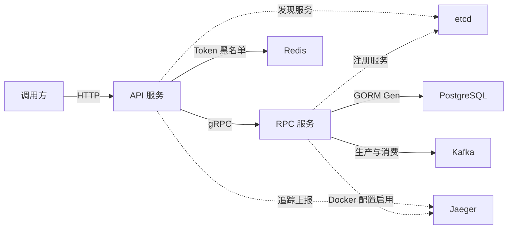

# go-zero 框架学习与项目实践

> 适用对象：具备 Go 基础、希望熟悉 go-zero 开发的团队成员。  
> 项目定位：通过用户服务，学习接口定义、代码生成、服务分层、RPC、鉴权、事务和可观测性。

## 1. 学习目标

通过本项目，我们需要掌握：

- 理解 go-zero 的服务结构与各层职责。
- 使用 `.api`、`.proto` 定义接口并生成代码。
- 跟踪一次 HTTP → RPC → 数据库的完整请求。
- 理解配置加载、依赖注入和 Context 传递。
- 实现 JWT 鉴权、业务权限判断与统一错误处理。
- 熟悉事务、Kafka、SSE 和链路追踪的接入方式。

## 2. go-zero 在项目中的作用

go-zero 提供 HTTP 服务组件 `rest`、RPC 组件 `zrpc`，以及配置、日志、追踪和服务治理等配套能力。代码生成工具 `goctl` 根据接口契约生成服务骨架，开发者在骨架中实现业务逻辑。[官方术语说明](https://go-zero.dev/concepts/glossary/)

项目中的能力可以分为：

| 能力 | 使用方式 | 来源 |
| --- | --- | --- |
| HTTP 服务 | `rest`、路由注册、请求绑定 | go-zero |
| RPC 通信 | `zrpc`、生成的客户端与服务端 | go-zero |
| 服务发现 | etcd | go-zero 集成 |
| 登录与权限 | JWT 签发、资源归属、角色检查 | 项目代码 |
| 统一响应 | 业务错误码、响应信封 | 项目代码 |
| 数据访问 | PostgreSQL、GORM、GORM Gen | 独立数据库组件 |
| 消息队列 | `go-queue/kq` | go-zero 生态组件 |
| 部署编排 | Docker Compose | 部署工具 |

本项目使用 GORM Gen 生成数据库访问代码。

当前仓库版本：

| 项目 | 版本 |
| --- | --- |
| Go | `1.26.5` |
| go-zero | `v1.10.3` |
| goctl | 生成文件记录为 `1.10.2` |
| go-queue | `v1.2.2` |
| GORM | `v1.31.2` |
| GORM Gen | `v0.3.29` |

团队应统一生成工具版本，升级时检查生成差异。

## 3. 项目架构



API 服务负责 HTTP 协议、登录、权限判断和 RPC 调用；RPC 服务负责用户数据操作、数据库事务及消息处理。

etcd 保存服务发现信息，API 与 RPC 直接建立连接进行业务通信。

主要目录：

```text
user/
├── api/
│   ├── user.api             # HTTP 接口契约
│   ├── user.go              # API 入口
│   ├── etc/                 # 配置
│   ├── common/
│   │   ├── errcode/         # 业务错误码
│   │   └── response/        # 统一响应结构
│   └── internal/
│       ├── config/          # 配置结构
│       ├── handler/         # HTTP 协议适配
│       ├── logic/           # API 业务逻辑
│       ├── middleware/      # 自定义中间件
│       ├── svc/             # 依赖容器
│       └── types/           # 请求、响应类型
├── rpc/
│   ├── user.proto           # RPC 接口契约
│   ├── user.go              # RPC 入口
│   ├── user/                # Protobuf 生成代码
│   ├── userclient/          # RPC 客户端封装
│   ├── cmd/gen/             # GORM Gen 入口
│   ├── migrations/          # 初始化 SQL
│   ├── etc/                 # 配置
│   └── internal/
│       ├── server/          # RPC 方法分发
│       ├── logic/           # RPC 业务逻辑
│       ├── svc/             # 依赖容器
│       ├── db/              # 数据库初始化
│       ├── dal/             # 数据模型和查询代码
│       ├── dberr/           # 数据库错误分类
│       └── mqs/             # Kafka 消费
├── docker-compose.yml
└── build.sh
```

## 4. 各层职责

| 层 | 职责 | 项目例子 |
| --- | --- | --- |
| Handler | 解析请求、读取 Header、写出响应 | Multipart 上传解析 |
| API Logic | 权限判断、用例组织、RPC 调用、结果转换 | 查询本人资料 |
| RPC Server | 将 RPC 方法转交给 Logic | `UserServer` |
| RPC Logic | 数据操作、事务、数据库错误处理 | 创建用户与待办 |
| DAL | 数据模型和类型化查询 | `User`、`Todo` 查询 |
| ServiceContext | 保存服务共享依赖 | RPC 客户端、Redis、数据库连接池 |

HTTP 请求结构、RPC Message 和数据库 Model 分别描述不同边界。

例如，普通用户查询不应返回密码哈希；本项目普通查询 RPC 没有该字段，数据库 Model 的 `Password` 也设置了 `json:"-"`。

## 5. 一次请求如何完成

以 `GET /user/:id` 为例：

```text
HTTP 请求
  → 路由
  → GetUserInfoHandler
  → GetUserInfoLogic
  → UserRpc.QueryUser
  → UserServer
  → QueryUserLogic
  → GORM Gen 查询 PostgreSQL
  → 返回并转换结果
  → 统一 JSON 响应
```

建议现场依次打开：

1. `api/user.api`
2. `api/internal/handler/routes.go`
3. `api/internal/handler/getuserinfohandler.go`
4. `api/internal/logic/getuserinfologic.go`
5. `rpc/userclient/user.go`
6. `rpc/internal/server/userserver.go`
7. `rpc/internal/logic/queryuserlogic.go`

重点观察三个位置：

**参数绑定。** `UserInfoReq` 使用 `path:"id"`，由请求解析器取得路径参数。

**业务校验。** API Logic 检查 ID 是否有效，RPC Logic 也检查调用参数。RPC 应能独立处理来自不同调用方的请求。

**错误传播。** 用户不存在与数据库故障分别返回不同的 gRPC 状态，再由 API 转为业务错误码。

## 6. 配置、ServiceContext 与 Context

### 配置加载

API 入口使用：

```go
var c config.Config
conf.MustLoad(*configFile, &c)
```

API 配置内嵌 `rest.RestConf`，RPC 配置内嵌 `zrpc.RpcServerConf`。项目自定义配置与框架配置共同组成完整配置结构。

新增配置需要完成三步：

1. 在配置结构体声明字段。
2. 在 YAML 中填写值。
3. 在依赖初始化或业务代码中使用。

配置字段只有被实际读取，才会影响运行行为。

### ServiceContext

ServiceContext 是项目显式管理依赖的位置。

API 保存：

- RPC 客户端。
- Redis 客户端。
- 黑名单中间件。
- 配置。

RPC 保存：

- GORM 数据库连接。
- GORM Gen Query。
- Redis 客户端。
- Kafka Pusher。
- 配置。

这些依赖在启动时创建并复用。当前用户、请求参数等数据属于请求级状态，应通过函数参数或 Context 传递。

### Context

项目将 `r.Context()` 传入 API Logic，继续用于 RPC 调用；RPC 查询通过 `WithContext(l.ctx)` 使用请求上下文。

Context 用来传递：

- 请求取消信号。
- Deadline。
- 追踪信息。
- 认证后的 Claims。

下游调用应保留上游 Context，耗时任务也应主动响应取消。

## 7. 接口契约与代码生成

### HTTP 契约

`.api` 描述请求、响应、路由和路由组能力。例如：

```text
@server (
    jwt: Auth
    middleware: JwtBlacklist
)
service user-api {
    @handler GetProfile
    get /user/profile/:userId (ProfileReq) returns (ProfileResp)
}
```

这里：

- `@handler` 指定处理函数。
- `jwt: Auth` 指定 JWT 配置。
- `middleware` 指定自定义中间件。
- `:userId` 表示路径参数。

语法详见 [官方 API DSL 参考](https://go-zero.dev/reference/api-dsl/)。

### 生成命令

从项目 `user/` 目录执行：

```powershell
# HTTP 骨架
goctl api go -api api/user.api -dir api -style gozero

# RPC 与 Protobuf 代码
Push-Location rpc
goctl rpc protoc user.proto --go_out=. --go-grpc_out=. --zrpc_out=. --style gozero
Pop-Location

# 根据数据库表生成 DAL
go run ./rpc/cmd/gen
```

生成 RPC 还需要安装 protoc、`protoc-gen-go` 和 `protoc-gen-go-grpc`。命令说明见 [官方 goctl 参考](https://go-zero.dev/reference/cli-guide/)。

DAL 生成器当前使用代码中固定的本地数据库连接配置，修改运行时 YAML 不会改变生成器的连接地址。

生成前后应检查 `git diff`。本项目手动调整了 Handler 的 `parse`、`okJson`，以及上传、退出、SSE 处理，重新生成后需要确认这些行为保留。

推荐开发顺序：

```text
修改契约 → 生成代码 → 注入依赖 → 实现 Logic → 接入响应约定 → 验证
```

## 8. JWT、中间件与权限

项目包含三种中间件接入方式：

| 方式 | 示例 |
| --- | --- |
| 框架内置能力 | JWT、日志、追踪等 |
| 全局自定义中间件 | `server.Use(...)` 添加响应头 |
| 路由组自定义中间件 | `JwtBlacklist` |

中间件包装 Handler，执行公共逻辑后调用 `next`。需要拒绝请求时，写出响应并返回。[官方中间件说明](https://go-zero.dev/guides/http/server/middleware/)

登录流程：

```text
提交用户名和密码
  → RPC 查询账号及密码哈希
  → API 使用 bcrypt 校验密码
  → 签发 Access Token 和 Refresh Token
```

认证成功后仍需要业务权限校验：

- `GetProfile`、`UpdateProfile` 检查当前用户 ID 与路径 ID 是否一致。
- `UpdateUserInfo` 检查角色是否为 `admin`。

退出登录会将当前 Access Token 写入 Redis 黑名单，TTL 为 Token 的剩余有效期。

当前实现的边界：

| 细节 | 当前行为 |
| --- | --- |
| Access Token 有效期 | 生成函数固定 24 小时，响应有效期读取配置，修改配置可能导致不一致 |
| Refresh Token 撤销 | Logout 只撤销当前 Access Token |
| Redis 黑名单查询失败 | 中间件继续执行后续请求 |
| RPC 鉴权 | 示例鉴权拦截器未注册，metadata 尚不构成有效认证 |
| API Redis DB | 配置结构有 `DB`，创建客户端时未使用 |

这些适合作为后续练习题。

## 9. 数据访问与事务

项目使用 PostgreSQL、GORM 和 GORM Gen：

```go
item, err := l.svcCtx.PostgresQuery.User.WithContext(l.ctx).
    Where(l.svcCtx.PostgresQuery.User.ID.Eq(in.GetId())).
    First()
```

数据库包含：

- `users`：用户信息。
- `todos`：待办，通过外键关联用户。

用户名和邮箱具有唯一索引，索引只约束未软删除的数据。

唯一性最终由数据库保证。并发场景下，即使先查重，也需要处理写入时的唯一键冲突。

创建用户和待办使用同一个事务：

```go
err = l.svcCtx.PostgresQuery.Transaction(func(tx *query.Query) error {
    if err := tx.User.WithContext(l.ctx).Create(newUser); err != nil {
        return err
    }

    newTodo.UserID = newUser.ID
    return tx.Todo.WithContext(l.ctx).Create(newTodo)
})
```

关键点：

- 事务内的操作都使用 `tx`。
- 任一步返回错误，整体回滚。
- bcrypt 在事务开始前执行，减少事务持有时间。

回滚演示将待办的 `user_id` 设置为 0，预期触发外键错误。演示前应使用全新用户名，演示后查询数据库确认用户没有残留。

当前演示把任何事务错误都作为回滚结果处理，因此还需要查看日志，确认确实触发了预期外键错误。

## 10. 统一响应与错误处理

错误处理链路：

```text
数据库错误
  → gRPC status
  → API 业务错误码
  → HTTP JSON 响应
```

| 场景 | gRPC 状态 | 业务码 |
| --- | --- | --- |
| 参数非法 | `InvalidArgument` | `9002` |
| 用户不存在 | `NotFound` | `1002` |
| 唯一键冲突 | `AlreadyExists` | `1001` |
| RPC 超时 | `DeadlineExceeded` | `9007` |
| 服务不可用 | `Unavailable` | `9006` |
| 内部故障 | 其他状态 | `9001` |

成功响应：

```json
{"code":0,"msg":"成功","data":{"id":18},"trace_id":"..."}
```

失败响应：

```json
{"code":1002,"msg":"用户不存在","trace_id":"..."}
```

经过项目业务响应处理器的结果统一返回 HTTP 200，由 `code` 表示业务成功或失败。SSE、框架直接处理的 404 和请求大小限制等出口需要分别理解。

JWT 未认证通过 `WithUnauthorizedCallback` 接入统一响应；请求解析错误转换为 `9002`。内部错误详情写入日志，避免直接返回数据库或 RPC 原始错误。

## 11. 扩展示例

### Kafka

`Pusher` RPC 向 `payment-success` 发送固定字符串 `zhangSan`，RPC 进程中的消费者收到消息后打印日志。

当前没有支付落库、消息去重和失败补偿逻辑。适合围绕 Topic、消费组、消费位点、幂等及消息一致性继续练习。

### SSE

SSE Handler 使用 Channel 接收 Logic 产生的数据，写出：

```text
data: {"msg":"message 0"}

```

随后 Flush，让客户端逐条收到消息。

项目使用 POST SSE，可用 curl 或流式 Fetch 演示。浏览器原生 `EventSource` 使用 GET，不能直接调用当前 POST 路由。

Handler 监听请求取消，Logic 的发送和 Sleep 尚未主动监听取消；扩展成长时间流时应补齐生产端退出机制。

### 文件上传

上传流程：

```text
解析 Multipart → 检测文件头 MIME → 重置文件指针
  → 校验大小 → 处理文件名 → 保存本地文件
```

三个大小配置含义不同：

| 数值 | 含义 |
| --- | --- |
| 64 MiB | 请求体上限 |
| 32 MiB | Multipart 内存缓存阈值 |
| 10 MiB | 业务单文件大小限制 |

返回的 `/files/...` 是约定路径，当前未注册静态下载路由。S3 仅有注释示例。

## 12. 启动与演示

以下命令以 `user/` 为工作目录。

先启动基础设施：

```powershell
docker compose up -d postgres etcd redis kafka kafka-ui jaeger
docker compose ps
go mod download
```

待基础设施健康后，先启动 RPC：

```powershell
go run ./rpc -f rpc/etc/user.yaml
```

再用另一个终端启动 API：

```powershell
go run ./api -f api/etc/user-api.yaml
```

数据库初始化 SQL 只在空数据卷首次初始化时执行，已有数据库需要检查并按需应用迁移。

如需全部运行在 Docker 中，先在 Bash 终端构建：

```bash
bash build.sh
docker compose up -d --build
```

现有 Dockerfile 复制宿主机构建的 Linux 二进制，具体原因见文件中的透明加密说明。

现场演示建议按以下顺序：

| 操作 | 预期结果 |
| --- | --- |
| `POST /users` 创建用户 | 返回用户 ID |
| 重复创建相同用户 | 业务码 `1001` |
| `POST /user/login` | 返回两种 Token |
| 无 Token 访问 Profile | 业务码 `9003` |
| 携带 Token 访问本人 Profile | 成功 |
| 访问其他用户 Profile | 业务码 `9004` |
| Logout 后再次使用旧 Access Token | 业务码 `1005` |
| 创建用户和待办 | 两条关联数据均存在 |
| 调用回滚演示 | 查询确认用户没有残留 |

SSE 和 Kafka 演示：

```powershell
curl.exe -N -X POST http://localhost:8888/sse/without/resp

# 需要安装 grpcurl；dev 模式启用了 RPC 反射
grpcurl -plaintext -d '{}' localhost:8080 user.User/Pusher
```

观察入口：

| 地址 | 用途 |
| --- | --- |
| `http://localhost:9091/metrics` | API 指标 |
| `http://localhost:16686` | Jaeger |
| `http://localhost:8081` | Kafka UI |

Compose 尚未部署 Prometheus 抓取服务和 Grafana。RPC 本地 YAML 未配置 Telemetry，Docker YAML 已配置；本机运行时需要补齐配置才能观察完整的 RPC 服务端追踪。